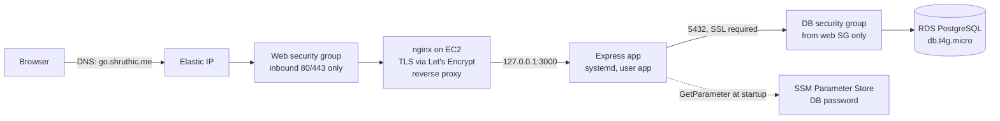
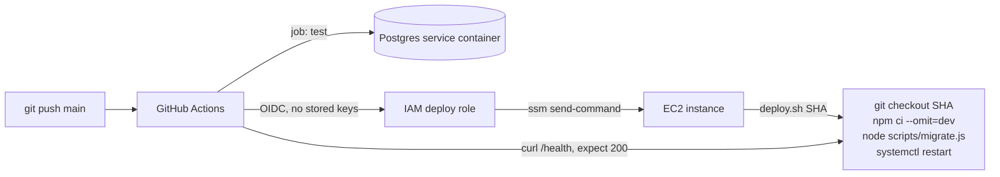
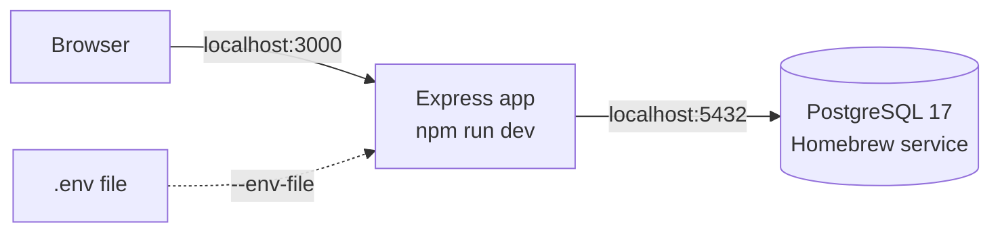

# Architecture

A URL shortener running on a single Amazon EC2 instance, with a managed PostgreSQL database
behind it. The app is deliberately small so the focus stays on how it's deployed, secured,
and operated.

This document is organized around five questions:

1. [Does it work?](#1-it-works) How to verify every requirement yourself.
2. [Why is it built this way?](#2-architecture-choices) Each choice, what was considered
   instead, and the tradeoff accepted.
3. [Is it secure and inside the free tier?](#3-security-and-cost)
4. [What broke, and how was it diagnosed?](#4-troubleshooting)
5. [What would change before real customers?](#5-before-real-customers)

New to AWS? The [glossary](#glossary) at the end explains every AWS term used here in one
sentence each.

---

## In plain English

When someone opens a short link like `https://go.shruthic.me/aZ3kP9`:

1. Their browser looks up `go.shruthic.me` and gets back a fixed public address on AWS.
2. The request reaches a firewall that only lets in web traffic (ports 80 and 443).
3. Inside the server, **nginx** decrypts the HTTPS request and hands it to the app.
4. The **app** looks up the code in the **database**, adds one to its click count, and
   replies "go to this long URL" (an HTTP 302 redirect).
5. The browser follows the redirect to the destination on its own.

The database sits behind its own firewall that only accepts connections from the server.
Nothing else on the internet can reach it.



Code reaches the server through an automated pipeline: every push to `main` is tested, then
deployed, then checked against the live health endpoint.



---

## 1. It works

**Live app:** https://go.shruthic.me <!-- confirm once deployed -->

Each requirement and how to check it:

| Requirement | How to verify |
|---|---|
| Public web page on EC2 | Open https://go.shruthic.me in any browser |
| Data is saved to the database | Shorten a URL on the page, or `curl -X POST https://go.shruthic.me/api/shorten -H 'Content-Type: application/json' -d '{"url":"https://example.com"}'` |
| Data is read back | Open the short link (redirects to the original), then refresh the page: the link appears in "Recent links" with its click count increased |
| Health check | `curl -i https://go.shruthic.me/health` returns `200` with `{"app":"ok","database":"ok"}` |

The health check tests the real database connection (`SELECT 1` with a 2-second timeout),
not just whether the process is running. If the database is unreachable, it returns `503`
with `"database":"error"`. This was tested by temporarily removing the database firewall
rule. <!-- confirm once tested -->

The deploy pipeline uses the same health check: a deploy only counts as successful when the
live site returns `200` afterward.

---

## 2. Architecture choices

Every choice below lists the reason, the main alternative considered, and the tradeoff
accepted. The guiding rule came from the assignment: a simple app deployed well beats a
complex one that barely runs.

### Overall shape: one app on one server

**Chose:** a single Express app on one EC2 instance, with a managed database.

**Considered:**
- *Serverless (API Gateway + Lambda + DynamoDB).* The textbook AWS design for a shortener,
  and cheaper at low traffic, but the assignment requires an EC2 instance.
- *Microservices with a cache.* My first design split redirects, shortening, and analytics
  into separate services, with Redis in front of the database and click counts buffered in
  memory and flushed by a cron job. On a single instance, the services would fail together
  anyway, so splitting them adds three deployments without adding resilience. A
  primary-key lookup on a small table is already fast, so a cache would add an
  invalidation problem for no gain. Buffered counts would be lost on a crash; one atomic
  SQL `UPDATE` does the same job safely.

**Tradeoff accepted:** one instance is a single point of failure. That's acceptable for a
demo and is the first item in [before real customers](#5-before-real-customers).

### Domain: a subdomain of an existing domain

**Chose:** `go.shruthic.me`, an A record at Namecheap pointing to the Elastic IP.

**Considered:** the root domain `shruthic.me`, which already hosts another site. DNS routes
whole hostnames, not paths, so pointing the root at EC2 would take that site down. Serving
both from one hostname would need a path-based proxy in front of both. Also considered
Route 53, which integrates with AWS but bills monthly per hosted zone.

**Tradeoff accepted:** short links are a few characters longer.

### Region and network: us-east-2, default VPC

**Chose:** Ohio (us-east-2), because this account uses the AWS Projects console, where each
project is pinned to one region at creation; and the VPC every AWS account comes with.
Ohio is free-tier eligible like any other US region, and the extra latency from the west
coast is tens of milliseconds, which does not matter for a redirect service.

**Considered:** a custom VPC with private subnets for the server. Instances in private
subnets need a NAT gateway to reach the internet, which has an hourly cost.

**Tradeoff accepted:** the server sits in a public subnet. Isolation comes from security
groups instead (see [security](#3-security-and-cost)).

### Entry point: an Elastic IP

**Chose:** a fixed public IP attached to the instance.

**Considered:**
- *The instance's default public IP.* It changes whenever the instance stops and starts,
  which would break DNS.
- *An Application Load Balancer.* Adds health-checked routing, AWS-managed certificates,
  and the ability to run several instances, but has an hourly cost and adds little in front
  of one instance.

**Tradeoff accepted:** no automatic failover, and TLS certificates are managed on the
instance rather than by AWS.

### Compute: EC2 t3.micro, standard credit mode

**Chose:** t3.micro (2 vCPUs, 1 GB RAM). It's free-tier eligible and plenty for nginx plus a
small Node app. It's a *burstable* type: it earns CPU credits while idle and spends them
during spikes, which suits low, spiky traffic. Standard credit mode means it can never bill
for extra bursting.

**Considered:**
- *t4g (Graviton, ARM).* Better price-performance, but ARM would add an architecture
  variable to a first deployment.
- *t3.small.* Twice the RAM, which this app doesn't need, at a higher credit burn.

**Tradeoff accepted:** under sustained heavy load, the instance would be throttled to its
baseline CPU rather than scaling up.

### Operating system: Amazon Linux 2023

**Chose:** AL2023. The SSM agent and AWS CLI come preinstalled, and both the deploy
pipeline and shell access depend on SSM. AWS maintains it specifically for EC2.

**Considered:** Ubuntu 24.04 LTS, which has a larger community and more tutorials.

**Tradeoff accepted:** fewer community answers for distro-specific problems.

### Web server: nginx in front of the app

**Chose:** nginx terminates HTTPS (Let's Encrypt certificate, auto-renewed by certbot),
redirects HTTP to HTTPS, and forwards requests to the app.

**Considered:** having Node serve traffic directly. The app would have to handle TLS itself,
and binding to ports below 1024 requires root, so the app would run with more privilege
than it needs.

**Tradeoff accepted:** one more component to configure and keep running.

### App binding: localhost only

**Chose:** the app listens on `127.0.0.1:3000`, so only programs on the same machine (nginx)
can reach it.

**Considered:** binding to `0.0.0.0`, which also works.

**Tradeoff accepted:** none meaningful. This is a free second layer of protection: even if a
firewall rule were misconfigured, the app still couldn't be reached from outside.

### Process management: systemd

**Chose:** a systemd service that starts the app on boot, restarts it if it crashes, runs it
as a dedicated non-root `app` user, and sends logs to journald.

**Considered:** Docker, for reproducible builds. It adds another layer on a 1 GB instance
for an app with three runtime dependencies.

**Tradeoff accepted:** the server's Node version must be kept in step with the version
pinned in `.nvmrc` by hand.

### Database: RDS PostgreSQL

**Chose:** db.t4g.micro, single-AZ, 20 GB, not publicly accessible, SSL required. AWS
handles backups and patching, and the data lives independently of the web server, so the
server can be replaced without losing anything.

**Considered:**
- *PostgreSQL installed on the EC2 instance.* No extra resource to pay for, but the
  database would share the server's failure point and its 1 GB of RAM, and backups would
  be manual.
- *DynamoDB.* A natural fit for key-value lookups and uses no credits, but relational
  storage is simpler to reason about here, and RDS demonstrates network-level isolation
  (a private database reachable only through firewall rules).

**Tradeoff accepted:** single-AZ means a datacenter outage would take the database down
until it recovers. RDS also draws a small amount from the account's free-plan credits.

### Secrets: SSM Parameter Store

**Chose:** the database password is stored encrypted (SecureString). The app fetches it at
startup through the instance's IAM role. It never appears in the repo, in files on the
server, in GitHub, or in logs.

**Considered:**
- *AWS Secrets Manager.* Adds automatic rotation, but bills monthly per secret.
- *A `.env` file on the server.* Simple, but leaves the password on disk.

**Tradeoff accepted:** no automatic password rotation.

### Admin access: Session Manager, no SSH

**Chose:** shell access through SSM Session Manager, which authenticates with IAM and
records sessions. Port 22 is closed and the instance has no key pair.

**Considered:** SSH restricted to my IP address. That means managing key files, and the
rule breaks whenever my home IP changes.

**Tradeoff accepted:** shell access depends on the SSM agent being healthy.

### Deployment: GitHub Actions + OIDC + SSM Run Command

**Chose:** on every push to `main`, tests run against a real Postgres container. If they
pass, the workflow signs in to AWS with OIDC (short-lived credentials, no stored keys),
tells SSM to run `deploy.sh` on the instance with the exact commit SHA, waits for it, and
fails unless `/health` returns `200` afterward. A concurrency group prevents overlapping
deploys.

**Considered:** SSH-based deploys with a private key stored in GitHub secrets. That needs
port 22 open to GitHub's constantly changing IP ranges and a long-lived credential.

**Tradeoff accepted:** a restart means a few seconds of downtime per deploy. There's no
blue-green or rolling deploy with a single instance.

---

## 3. Security and cost

### Open ports

| Firewall | Inbound rule | Why |
|---|---|---|
| Web security group | 443 from anywhere | HTTPS traffic |
| Web security group | 80 from anywhere | Redirects to HTTPS; needed for certificate renewal |
| DB security group | 5432 from the web security group only | The app's database connection |

Everything else is closed, including SSH (22), the app's port (3000), and public access to
the database. The DB rule references the web security group rather than an IP address, so a
replacement server is allowed automatically and nothing else ever is.

### Layers of protection

From outside, only nginx on ports 80 and 443 is reachable. Behind it:

- The app listens only on localhost.
- The app runs as a non-root user that owns only its own directory.
- The database has no public address and accepts connections only from the web server.
- The database connection is encrypted, and the RDS certificate is verified.

### Access and identity

| Identity | Can do | Cannot do |
|---|---|---|
| EC2 instance role | Register with SSM; read one parameter (`/url-shortener/db-password`) | Anything else in the account |
| GitHub deploy role | Send the run-shell-script command to this one instance; read the result | Anything else. It can only be assumed by this repo's `main` branch |

### Secrets

| Secret | Where it lives | Where it never appears |
|---|---|---|
| Database password | Parameter Store (encrypted) | Repo, server disk, GitHub, logs |
| AWS credentials for deploys | None stored; OIDC issues short-lived ones per run | GitHub secrets, repo |
| TLS private key | On the instance, managed by certbot | Repo |

The GitHub repo stores only three non-secret repository variables: the deploy role's ARN,
the instance ID, and the region.

### App-level protections

- All SQL is parameterized; there is no string concatenation into queries.
- URLs are validated with the built-in `URL` parser: only `http` and `https`, at most 2048
  characters, and never pointing back at the shortener itself.
- The frontend builds the page with `textContent`, never `innerHTML`, so stored URLs can't
  inject markup.
- Logs record method, path, status, and duration only.

### Cost

The account is on the AWS Free plan, which cannot bill beyond its credits, and a budget
alert emails me at a low threshold.

| Resource | How it stays free |
|---|---|
| EC2 t3.micro | Free-tier eligible; standard credit mode prevents burst charges |
| RDS db.t4g.micro | Free-plan eligible; single-AZ; storage autoscaling off so it can't grow past 20 GB |
| Elastic IP / public IPv4 | One address, always attached to the running instance |
| Parameter Store | Standard tier is free |
| DNS | Namecheap, free with the domain |
| TLS certificate | Let's Encrypt, free |
| GitHub Actions | Free for public repos |

Deliberately avoided because they bill: NAT gateway, Application Load Balancer, Route 53
hosted zone, Secrets Manager, RDS Multi-AZ.

---

## 4. Troubleshooting

### How I diagnose problems

Work from the outside in, following the request path, and check each layer's own evidence:

| Symptom | Check | Likely layer |
|---|---|---|
| Browser can't resolve the name | `dig go.shruthic.me` | DNS record |
| Connection times out | Security group inbound rules; is the instance running? | Firewall |
| `502 Bad Gateway` | `systemctl status url-shortener`; `curl localhost:3000/health` on the instance | App is down; nginx is fine |
| App won't start | `journalctl -u url-shortener -n 50` | Config, password fetch, or DB connection |
| `/health` returns `503` | `psql` to the RDS endpoint from the instance | DB security group or RDS |
| Certbot fails | `dig` result and port 80 rule | DNS not propagated, or port 80 closed |
| Deploy job fails | SSM command output in the Actions log | `deploy.sh` step that exited non-zero |

### Issues encountered

<!--
Record real issues here as they happen. For each one:
symptom → what I checked → the actual cause → the fix → what I'd do to prevent it.
One of these becomes the "what went wrong" segment of the demo video.
-->

**Design issue: migrations couldn't see the database config.**
`deploy.sh` runs `scripts/migrate.js` outside systemd, so the database settings defined in
the systemd unit wouldn't exist in that shell, and the migration would fail to connect.
*Fix:* the non-secret settings live in one environment file
(`/etc/url-shortener/app.env`), which the systemd unit loads with `EnvironmentFile=` and
`deploy.sh` loads before running the migration. Both read the same file, so they can't
drift apart. It contains no secrets: the password still comes from Parameter Store.

---

## 5. Before real customers

Each item is a deliberate tradeoff from section 2, ordered by impact:

1. **Application Load Balancer + Auto Scaling group** across two availability zones, so a
   failed server is replaced automatically and deploys can roll without downtime.
2. **RDS Multi-AZ** for a standby database in a second datacenter.
3. **Monitoring and alerts**: a CloudWatch alarm on `/health` and on instance status
   checks, so I find out before users do.
4. **Rate limiting** on `POST /api/shorten`, plus abuse handling, since public shorteners
   attract phishing links.
5. **Remove the public recent-links list**, which exists only to demonstrate database reads.
6. **Custom VPC with private subnets** for the app and database.
7. **Secrets Manager** with automatic password rotation.
8. **A real migration tool** once the schema needs to change.
9. **Docker images** built in CI, so the server runs exactly what was tested.

---

## Appendix: how the app is built

### Process layout

```
src/server.js       entry point: config, pool, listen, graceful shutdown
  └─ src/app.js     Express app (routes + middleware), exported for tests
       ├─ src/db.js         pg Pool, password resolution, SSL config
       ├─ src/shortcode.js  7-character code generation (crypto.randomInt)
       └─ src/validate.js   URL validation
scripts/migrate.js  applies db/schema.sql using the same pool code
public/             static frontend, no build step
```

### Routes

| Route | What it does |
|---|---|
| `POST /api/shorten` | Validates, inserts with a random code; retries up to 3 times on a duplicate code |
| `GET /:code` | One atomic `UPDATE ... RETURNING long_url` increments the count and fetches the URL; `302` or `404` |
| `GET /api/links` | 10 most recent links with click counts |
| `GET /health` | `SELECT 1` raced against a 2-second timer; `200` or `503` |

### Database

```sql
CREATE TABLE IF NOT EXISTS links (
  short_code  CHAR(7) PRIMARY KEY,
  long_url    TEXT NOT NULL,
  used_count  INTEGER NOT NULL DEFAULT 0,
  created_at  TIMESTAMPTZ NOT NULL DEFAULT now()
);
```

The schema is idempotent, so it runs safely on every deploy.

### Local development



The code is identical locally and on AWS; only environment variables change.

### Testing

`node --test` with `supertest` against a real Postgres (a separate test database locally, a
service container in CI). No mocks. Every route is covered, including the `503` health path.

---

## Glossary

- **EC2**: a virtual Linux server rented from AWS.
- **Elastic IP**: a public IP address you reserve so it never changes.
- **Security group**: a firewall around a resource, listing exactly which traffic may enter.
- **VPC**: your private network inside AWS.
- **RDS**: a database server that AWS runs, backs up, and patches for you.
- **IAM role**: an identity with specific permissions that a service or workflow can use,
  instead of a password or key.
- **OIDC**: a way for GitHub to prove "this is a workflow from this repo" to AWS, in
  exchange for credentials that expire within the hour.
- **SSM (Systems Manager)**: an AWS service with an agent on the server, used here to run
  deploy commands, open shell sessions, and store the database password.
- **nginx**: a web server that sits in front of the app, handling HTTPS and passing
  requests through.
- **systemd**: the Linux service manager that keeps the app running.
- **Availability zone**: a physically separate datacenter within an AWS region.