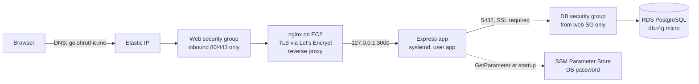
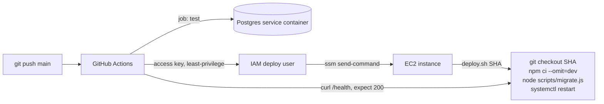

# URL Shortener

A small URL shortener (Node.js, Express, PostgreSQL) running on a single Amazon EC2 instance
behind nginx, with the database on Amazon RDS. Built for a DevOps take-home where the app is
deliberately simple and the grade is for how well it is deployed and operated.

**Live:** https://go.shruthic.me  **Health:** https://go.shruthic.me/health

- [ARCHITECTURE.md](ARCHITECTURE.md): every design choice, what was considered instead,
  security and cost, and the issues hit along the way.
- [deploy/SETUP.md](deploy/SETUP.md): the one-time console and instance checklist that
  produced the live system.

## Run locally

Prerequisites: Node 22 (see `.nvmrc`) and PostgreSQL 17.

```bash
# 1. Database role and two databases (dev and test)
createuser --pwprompt shortener
createdb --owner shortener urlshortener
createdb --owner shortener urlshortener_test

# 2. Config: .env is gitignored; only DB_PASSWORD needs a real value
cp .env.example .env

# 3. Install, create the table, run
npm install
npm run migrate
npm run dev          # http://localhost:3000

# 4. Tests (real Postgres, no mocks; uses urlshortener_test and truncates between tests)
npm test
```

Configuration is entirely environment variables, loaded from `.env` with Node's built-in
`--env-file` flag. See `.env.example` for the full list.

## API

| Route | Result |
|---|---|
| `GET /` | The web page: shorten a URL, copy the result, see recent links with click counts |
| `POST /api/shorten` with `{"url": "..."}` | `201` `{"code","short_url","long_url"}`, or `400` `{"error"}` |
| `GET /api/links` | `200` the 10 most recent links |
| `GET /:code` (7 alphanumeric chars) | `302` to the long URL and increments its count, or `404` |
| `GET /health` | `200` `{"app":"ok","database":"ok"}` or `503` if the database is unreachable |

```bash
curl -X POST https://go.shruthic.me/api/shorten \
  -H 'Content-Type: application/json' -d '{"url":"https://example.com"}'

curl -i https://go.shruthic.me/health
```

URLs must be `http` or `https`, at most 2048 characters, and not point back at the
shortener. Codes are 7 random characters from `crypto.randomInt`; a collision is retried
up to 3 times.

## How it is deployed



| Resource | Setting | Why |
|---|---|---|
| Region | us-east-2 (Ohio) | The AWS free-plan project is pinned to one region |
| EC2 | t3.micro, Amazon Linux 2023, standard credit mode, no key pair | Free-tier eligible; AL2023 ships the SSM agent; standard mode can never bill for bursts |
| Elastic IP | One, attached to the instance | A fixed address so the DNS record never breaks |
| Security group `url-shortener-web` | Inbound 80 and 443 from anywhere | Only nginx is reachable; no SSH |
| Security group `url-shortener-db` | Inbound 5432 from the web group only | The database accepts the app and nothing else |
| RDS | PostgreSQL 17, db.t4g.micro, single-AZ, 20 GB, not public, SSL required | Managed backups and patching; data outlives the server |
| Parameter Store | `/url-shortener/db-password` as SecureString | The password is never in the repo, on disk, in GitHub, or in logs |
| EC2 instance role | `AmazonSSMManagedInstanceCore` + read that one parameter | The server can register with SSM and fetch its password, nothing more |
| nginx + certbot | Terminates HTTPS, redirects HTTP, proxies to port 3000 | Let's Encrypt certificate, renewed by a systemd timer |
| systemd | `url-shortener.service`, user `app`, restart on failure | Starts on boot, survives crashes, logs to journald |
| Session Manager | Shell access through SSM | No port 22, no keys to manage |
| Namecheap DNS | A record `go` to the Elastic IP | Subdomain of an existing domain |

On the instance the code lives in `/opt/app`, owned by the unprivileged `app` user.
Non-secret settings live in `/etc/url-shortener/app.env`, which both the systemd unit and
the deploy script read, so the app and the migration always see the same config. Logs go
to journald (`journalctl -u url-shortener`). The files that define all this are in
[`deploy/`](deploy/) and the IAM policies in [`infra/`](infra/).

## How CI/CD works



Every push to `main` runs [`.github/workflows/deploy.yml`](.github/workflows/deploy.yml):

1. **Test job.** Starts a Postgres 17 container, installs dependencies, applies the schema
   with the same migration script the server uses, and runs `npm test`.
2. **Deploy job** (only if tests pass). Signs in to AWS as a dedicated IAM user whose only
   permission is to run the `AWS-RunShellScript` document on this one instance. Sends
   `deploy.sh <commit SHA>` through SSM Run Command, waits, prints the script's output in
   the Actions log, and fails if the script failed.
3. **Verify.** Polls `https://go.shruthic.me/health` and fails unless it returns 200.

A concurrency group stops two deploys from overlapping. GitHub holds two variables
(instance ID, region) and two secrets (the deploy user's access key). The original design
used OIDC so GitHub would hold no credentials at all; the free-plan account's organization
policy denies creating an OIDC provider, so a least-privilege IAM user is the narrowest
fallback. Details in
[ARCHITECTURE.md, issues encountered](ARCHITECTURE.md#issues-encountered).

`deploy.sh` itself: check out the exact commit as user `app`, `npm ci --omit=dev`, apply
`db/schema.sql` (idempotent, safe to repeat), restart the service, and wait for the local
health check before reporting success.

## Security and cost in brief

- Open ports: 80 and 443 on the web server. Nothing else, anywhere.
- The app binds to localhost only; the database has no public address.
- Secrets: database password in Parameter Store, read at startup through the instance
  role; deploy key in GitHub encrypted secrets; TLS key on the instance. None in the repo.
- All SQL is parameterized. URLs are validated with the built-in `URL` parser. The frontend
  uses `textContent`, never `innerHTML`.
- Cost: every resource is free-tier eligible, storage autoscaling is off, and a zero-spend
  budget alert is set. Deliberately avoided: NAT gateway, load balancer, Route 53,
  Secrets Manager, Multi-AZ.

## Before real customers

Each of these is a deliberate tradeoff for a free-tier demo, in priority order:

1. Application Load Balancer + Auto Scaling group across two availability zones
2. RDS Multi-AZ
3. Monitoring and alerts on `/health` and instance status checks
4. Rate limiting and abuse handling on `POST /api/shorten`
5. Remove the public recent-links list
6. Custom VPC with private subnets
7. Secrets Manager with automatic password rotation
8. A real migration tool once the schema needs to change
9. Docker images built in CI
10. OIDC federation for deploys, in an account that allows it

## Repo layout

```
src/server.js         starts Express, graceful shutdown
src/app.js            routes (exported for tests, no listen)
src/db.js             pool, password resolution, SSL config
src/shortcode.js      code generation
src/validate.js       URL validation
scripts/migrate.js    applies db/schema.sql
db/schema.sql
public/               index.html, app.js, styles.css
test/
deploy/               deploy.sh, url-shortener.service, nginx.conf, app.env.example, SETUP.md
infra/                IAM policy documents
.github/workflows/deploy.yml
ARCHITECTURE.md       design decisions, security, cost, troubleshooting
CLAUDE.md             project conventions
```
